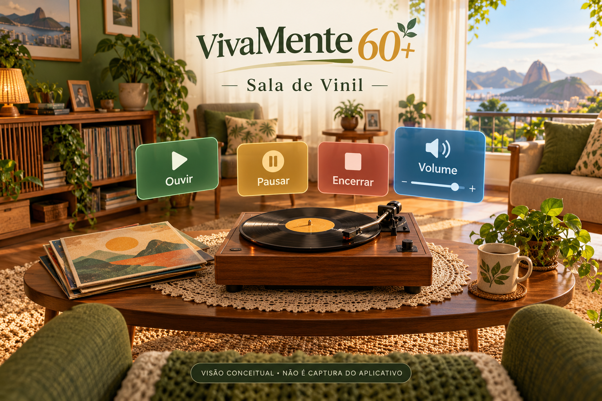
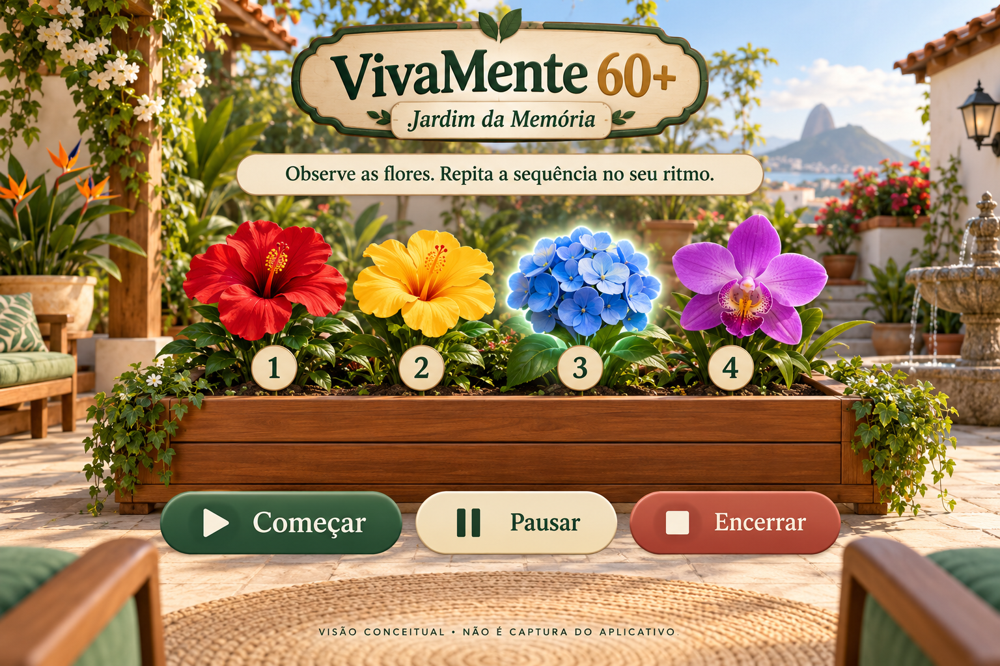

# VivaMente 60+ — Tecnologia para um envelhecimento ativo

Nome internacional de referência: **LiveMind 60+**.

## Demonstração visual da proposta

**Ilustrações conceituais geradas com IA; não são capturas do aplicativo nem comprovam execução em VR.** Representam a direção visual desejada. O código atual usa formas básicas; cenários detalhados, mobiliário e flores destas imagens não estão implementados.





[Origem e prompts das imagens](docs/images/PROVENIENCIA.md).

## Personalização e sala de vinil

Uma segunda cena simula um toca-discos com seleção de faixa, ouvir/pausar/retomar, volume e encerramento. O disco gira somente durante a reprodução. Sem músicas importadas, toca uma pequena melodia sintética identificada como demonstração; não inclui gravações comerciais.

No menu **VivaMente > Criar cena Sala de Vinil**, gere a cena. Para personalizar, use **Assets > Create > VivaMente > Perfil de experiência**. Selecione o objeto da sala e arraste o perfil para o campo Profile. O perfil permite definir título, pergunta para conversa, cor da sala, volume inicial e faixas/títulos. Importe arquivos de áudio que tenha direito de usar para Assets e arraste os AudioClips para Tracks. Ajuste Track Titles na mesma ordem. Salve a cena. A sala gerada fica em primeiro lugar na lista de build; não há menu interno de troca de cenas nesta etapa.

A escolha de músicas e objetos deve ser da pessoa, com opção de trocar ou parar. Temas futuros podem incluir rádio, fotografias, cinema e objetos do cotidiano, sem presumir que todos tenham as mesmas lembranças. Não há gravação de relatos nem perfil pessoal persistente. Veja [PERSONALIZACAO.md](docs/PERSONALIZACAO.md).

Base inicial de projeto Unity para Meta Quest com OpenXR. **Ainda não compilada no Unity nem testada em headset. Não há APK pronto.**

## Primeiro exercício: Jardim da Memória

Observe uma sequência de flores numeradas e selecione-as na mesma ordem. O código inclui quatro alvos, sequências ajustáveis de 2 a 5 itens, dois ritmos de apresentação, pausa/retomada e encerramento. Erros não avançam a sequência; não há limite de tempo para responder. A dificuldade é escolhida manualmente entre rodadas. A câmera permanece parada no ambiente, com rastreamento da cabeça e seleção por raio dos controles. O mouse oferece uma alternativa inicial no computador.

## Abrir e experimentar

1. Instale pelo Unity Hub o **Unity 6000.0.66f2** com Android Build Support, SDK/NDK e OpenJDK. Esta é a versão de referência; a compatibilidade dos pacotes ainda precisa ser confirmada pelo editor.
2. Adicione esta pasta como projeto no Hub. Aguarde a importação dos pacotes. Usa o renderizador Built-in e materiais Standard.
3. Em Project Settings > Player > Active Input Handling, selecione **Input System Package (New)** (ou Both) e reinicie se solicitado.
4. Selecione **VivaMente > Criar cena Jardim da Memória**. O comando gera e salva uma cena e a define como a única cena da lista de build. Salve cenas anteriores quando solicitado. A geometria e os controles são construídos ao iniciar o Play.
5. Pressione Play e use o mouse: Começar → observar → clicar nas flores. Encerrar permite ajustar ritmo e quantidade.

## Configurar VR no Meta Quest

1. Em Build Profiles, selecione Android. Em Player, configure identificador próprio, IL2CPP e ARM64.
2. Em XR Plug-in Management, habilite OpenXR para Android e Initialize XR on Startup. Em OpenXR, habilite o perfil Oculus Touch Controller e o grupo de recursos Meta Quest compatível com a versão instalada. Resolva os itens de Project Validation antes do build.
3. Para teste via Quest Link, habilite OpenXR também na plataforma Windows e selecione o runtime OpenXR correspondente no computador.
4. Faça Build and Run com o headset de desenvolvimento conectado. Teste ambos os controles, altura sentada, orientação, legibilidade e pausa. O protótipo solicita origem Device; verifique a altura no runtime usado antes de qualquer sessão.

A configuração XR do editor ainda precisa ser salva e versionada após a primeira importação. O Meta XR SDK, hand tracking, passthrough e XR Interaction Toolkit **não estão integrados** nesta base; não são necessários para a interação simples implementada com Unity XR. MR/AR será uma etapa posterior.

## Validação

Com .NET SDK 8 ou posterior:

```powershell
dotnet run --project tests/MemorySession.Tests
```

Os testes console cobrem regras de sequência, pausa, erros, conclusão, reset e cópia defensiva. Eles não validam renderização, tracking, controles ou conforto. Consulte [VALIDACAO.md](docs/VALIDACAO.md).

## Repositório remoto

O repositório Git local é independente. Para sincronizar futuras alterações com o remoto configurado:

```powershell
git push origin main
```

Não coloque tokens ou credenciais nos arquivos. O repositório é público para avaliação, conforme decisão do responsável pelo projeto.

## Escopo e dados

O protótipo não coleta identificação pessoal, não envia dados e não mantém histórico entre execuções. Tentativas extras são feedback da rodada, não uma medida clínica. Áudio guiado, exercícios motores, cooperação, acompanhamento longitudinal e avaliação profissional são próximos incrementos. Não há alegação de eficácia clínica ou de tratamento.

## Referências técnicas

Consultadas em 27/10/2026:

- [Unity OpenXR 1.14](https://docs.unity3d.com/Packages/com.unity.xr.openxr@1.14/manual/index.html)
- [Meta: XR Plugin Management](https://developers.meta.com/vr/documentation/unity/unity-xr-plugin/)

O conceito recebido está resumido em [PROJETO.md](docs/PROJETO.md).
